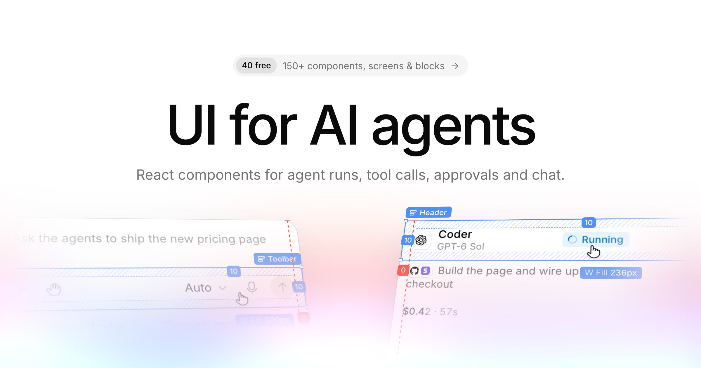

<p align="center">
  <a href="https://www.affectui.com">
    <picture>
      <source media="(prefers-color-scheme: dark)" srcset="./.github/assets/banner-dark.png">
      <source media="(prefers-color-scheme: light)" srcset="./.github/assets/banner-light.png">
      
    </picture>
  </a>
</p>

<p align="center">
  <a href="./LICENSE"></a>
  <a href="https://www.affectui.com/docs"></a>
  
  
  <a href="https://github.com/flohoeller/affectui/stargazers"></a>
</p>

<p align="center">
  <a href="https://www.affectui.com"><b>Website</b></a>
  &nbsp;·&nbsp;
  <a href="https://www.affectui.com/components"><b>Browse components</b></a>
  &nbsp;·&nbsp;
  <a href="https://www.affectui.com/docs"><b>Docs</b></a>
  &nbsp;·&nbsp;
  <a href="#install"><b>Install</b></a>
  &nbsp;·&nbsp;
  <a href="https://www.affectui.com/pricing"><b>Pro</b></a>
</p>

**UI for AI agents.** affectUI is a library of React components for what agents do – runs, tool calls, traces, handoffs, approvals and context – and for the rest of your app: inputs, menus, charts, screens, illustrations and motion. Every item is **one `.tsx` file with its styles inside**: no Tailwind, no CSS setup, no animation library. Install it with the shadcn CLI, or let Claude Code, Cursor or Codex add it through the MCP server, and it is source you own.

<p align="center">
  <picture>
    <source media="(prefers-color-scheme: dark)" srcset="./.github/assets/trust-dark.png">
    
  </picture>
</p>

## Showcase

Agent components, recorded live from [affectui.com](https://www.affectui.com). Items marked <sup>Pro</sup> are part of [affectUI Pro](https://www.affectui.com/pricing) and are not in this repository; everything else installs from here for free.

<table>
<tr>
<td width="50%" valign="top">
<a href="https://www.affectui.com/components/agent-tree"><picture>
<source media="(prefers-color-scheme: dark)" srcset="./.github/assets/showcase/agent-tree-dark.webp">

</picture></a>
<br><a href="https://www.affectui.com/components/agent-tree"><b>Agent Tree</b></a> <sup><a href="https://www.affectui.com/pricing">Pro</a></sup><br>
<sub>Who started whom</sub>
</td>
<td width="50%" valign="top">
<a href="https://www.affectui.com/components/tool-call-card"><picture>
<source media="(prefers-color-scheme: dark)" srcset="./.github/assets/showcase/tool-call-card-dark.webp">

</picture></a>
<br><a href="https://www.affectui.com/components/tool-call-card"><b>Tool Call Card</b></a><br>
<sub>An agent's tool call in one line</sub>
</td>
</tr>
<tr>
<td width="50%" valign="top">
<a href="https://www.affectui.com/components/trace-waterfall"><picture>
<source media="(prefers-color-scheme: dark)" srcset="./.github/assets/showcase/trace-waterfall-dark.webp">

</picture></a>
<br><a href="https://www.affectui.com/components/trace-waterfall"><b>Trace Waterfall</b></a> <sup><a href="https://www.affectui.com/pricing">Pro</a></sup><br>
<sub>Where the time and money of an agent run go</sub>
</td>
<td width="50%" valign="top">
<a href="https://www.affectui.com/components/decision-inbox"><picture>
<source media="(prefers-color-scheme: dark)" srcset="./.github/assets/showcase/decision-inbox-dark.webp">

</picture></a>
<br><a href="https://www.affectui.com/components/decision-inbox"><b>Decision Inbox</b></a><br>
<sub>Open decisions with two quick answers each</sub>
</td>
</tr>
<tr>
<td width="50%" valign="top">
<a href="https://www.affectui.com/components/agent-inbox"><picture>
<source media="(prefers-color-scheme: dark)" srcset="./.github/assets/showcase/agent-inbox-dark.webp">

</picture></a>
<br><a href="https://www.affectui.com/components/agent-inbox"><b>Agent Inbox</b></a> <sup><a href="https://www.affectui.com/pricing">Pro</a></sup><br>
<sub>All your background agent tasks in one calm list</sub>
</td>
<td width="50%" valign="top">
<a href="https://www.affectui.com/components/thinking-loader"><picture>
<source media="(prefers-color-scheme: dark)" srcset="./.github/assets/showcase/thinking-loader-dark.webp">

</picture></a>
<br><a href="https://www.affectui.com/components/thinking-loader"><b>Thinking Loader</b></a><br>
<sub>A small working pill for AI replies</sub>
</td>
</tr>
<tr>
<td width="50%" valign="top">
<a href="https://www.affectui.com/components/context-map"><picture>
<source media="(prefers-color-scheme: dark)" srcset="./.github/assets/showcase/context-map-dark.webp">

</picture></a>
<br><a href="https://www.affectui.com/components/context-map"><b>Context Map</b></a> <sup><a href="https://www.affectui.com/pricing">Pro</a></sup><br>
<sub>What fills an agent's context window, as a living treemap</sub>
</td>
<td width="50%" valign="top">
<a href="https://www.affectui.com/components/agent-handoff"><picture>
<source media="(prefers-color-scheme: dark)" srcset="./.github/assets/showcase/agent-handoff-dark.webp">

</picture></a>
<br><a href="https://www.affectui.com/components/agent-handoff"><b>Agent Handoff</b></a> <sup><a href="https://www.affectui.com/pricing">Pro</a></sup><br>
<sub>A task passed from agent to agent like a relay</sub>
</td>
</tr>
</table>

## Contents

- [Why affectUI](#why-affectui)
- [Choose the UI for your workflow](#choose-the-ui-for-your-workflow)
- [Install](#install)
- [Usage](#usage)
- [Use it with AI tools](#use-it-with-ai-tools)
- [Components](#components)
- [Blocks](#blocks)
- [Illustrations](#illustrations)
- [Motion](#motion)
- [affectUI Pro](#affectui-pro)
- [Contributing](#contributing)
- [License](#license)

## Why affectUI

- **Made for agents.** Components for what agents actually do: trees of sub-agents, tool calls, traces with cost per step, handoffs, approvals and the context window – live states, not static mockups.
- **Agent-ready.** An MCP server and `llms.txt` let Claude Code, Cursor, Codex or v0 find and add items for you.
- **One file each.** Every component is a single `.tsx` file with its styles inside. Nothing to configure, no CSS framework required.
- **Motion that feels finished.** Morphs, staggered reveals, rolling numbers and smooth state changes, and all of it respects `prefers-reduced-motion`.
- **Dark mode built in.** Each item switches when an ancestor has the class `dark` or `data-theme="dark"`.
- **Accessible by default.** Real buttons, labels, keyboard support and live regions where they matter.
- **Responsive.** Container queries, so items adapt to the space they get, not just the window.

## Choose the UI for your workflow

affectUI is the presentation layer of an AI product. Your application supplies runtime data, connects tools and enforces permissions; the components render that state and expose callbacks for your actions.

- **Agent UI:** task plans, run progress, decisions and outcomes for delegated work. Start with the [Agent UI guide](https://www.affectui.com/guides/agent-ui-react) or the [agent dashboard guide](https://www.affectui.com/guides/agent-dashboard-react).
- **AI chat UI:** composers, streaming answers, citations and reply actions. Read [React components for AI chat](https://www.affectui.com/guides/ai-chat-ui-components-react).
- **Human in the loop:** review a proposed action and its target before the backend executes it. Read [approvals and permissions](https://www.affectui.com/guides/human-in-the-loop-ui).
- **Tool-call UI:** make tool activity, results and failures readable. Read [tool calls in an agent UI](https://www.affectui.com/guides/tool-calls-agent-ui).
- **MCP UI:** present tools connected through MCP. The protocol connection and the finished interface are separate concerns; see the [MCP UI guide](https://www.affectui.com/guides/mcp-ui-react). The affectUI MCP server below helps coding assistants discover and install components.
- **Generative UI:** map model-selected tools and validated data to known React views. Read [generative UI in React](https://www.affectui.com/guides/generative-ui-react), including fallback states and why this does not require executing arbitrary generated code.

Browse all [guides](https://www.affectui.com/guides), follow the [AI setup docs](https://www.affectui.com/docs/ai), or [compare UI libraries](https://www.affectui.com/compare) to choose the pieces that fit your application.

## Install

### Requirements

- **React 19**, with or without TypeScript
- Any React setup: Next.js, Vite, Remix or plain React
- The `@/*` import alias if you use the shadcn CLI (Next.js and shadcn set it up by default)

### With the shadcn CLI

Every item has its own registry URL. Run the command from its page on [affectui.com](https://www.affectui.com) or from the tables below:

```bash
npx shadcn@latest add https://www.affectui.com/r/reaction-bar.json
```

The file lands in `components/ui`, ready to import.

Prefer short names? Register the namespace once in `components.json`:

```json
{
  "registries": {
    "@affectui": "https://www.affectui.com/r/{name}.json"
  }
}
```

```bash
npx shadcn@latest add @affectui/reaction-bar
```

### Copy and paste

Open the item's folder in this repository (`components/`, `illustrations/` or `motion/`), copy the file into your project and import it. That's all it takes.

## Usage

```tsx
import { ReactionBar } from "@/components/ui/reaction-bar";

export function PostActions({ post }) {
  return (
    <ReactionBar
      reactions={{ like: { count: post.likes, active: post.liked }, comment: { count: post.comments } }}
      onReact={(key, state) => api.react(post.id, key, state.active)}
    />
  );
}
```

Props, keyboard support and accessibility notes for every item are on its page, e.g. [Reaction Bar](https://www.affectui.com/components/reaction-bar).

## Use it with AI tools

affectUI is agent-ready. Connect the **MCP server** once and Claude Code, Cursor, VS Code or Codex can search every item, read its docs and add it for you:

```bash
claude mcp add --transport http affectui https://www.affectui.com/api/mcp
```

Other clients: add `{ "mcpServers": { "affectui": { "url": "https://www.affectui.com/api/mcp" } } }` to their MCP config. Without any setup, point your assistant at [`llms.txt`](https://www.affectui.com/llms.txt) or [`llms-full.txt`](https://www.affectui.com/llms-full.txt). Every page on affectui.com also has a **Copy prompt** bar for Claude, ChatGPT / Codex, Cursor and v0. Setup details: [Using with AI](https://www.affectui.com/docs/ai).

## Components

| Name | What it is | Install |
| --- | --- | --- |
| [Button](https://www.affectui.com/components/button) | Primary, secondary, ghost and destructive buttons with icons, sizes and a shimmering loading state | `npx shadcn@latest add https://www.affectui.com/r/button-clean.json`<br><sub>Classic style: `npx shadcn@latest add https://www.affectui.com/r/button.json`</sub> |
| [Change Summary](https://www.affectui.com/components/change-summary) | What moved since last time | `npx shadcn@latest add https://www.affectui.com/r/change-summary-clean.json`<br><sub>Classic style: `npx shadcn@latest add https://www.affectui.com/r/change-summary.json`</sub> |
| [Comment Thread](https://www.affectui.com/components/comment-thread) | One comment with replies | `npx shadcn@latest add https://www.affectui.com/r/comment-thread-clean.json`<br><sub>Classic style: `npx shadcn@latest add https://www.affectui.com/r/comment-thread.json`</sub> |
| [Decision Inbox](https://www.affectui.com/components/decision-inbox) | Open decisions with two quick answers each | `npx shadcn@latest add https://www.affectui.com/r/decision-inbox-clean.json`<br><sub>Classic style: `npx shadcn@latest add https://www.affectui.com/r/decision-inbox.json`</sub> |
| [Email Draft](https://www.affectui.com/components/email-draft) | Agent-written email for review | `npx shadcn@latest add https://www.affectui.com/r/email-draft-clean.json`<br><sub>Classic style: `npx shadcn@latest add https://www.affectui.com/r/email-draft.json`</sub> |
| [Filter Menu](https://www.affectui.com/components/filter-menu) | Grouped filters with removable chips, collapsible checkbox groups, Clear all and full keyboard control | `npx shadcn@latest add https://www.affectui.com/r/filter-menu-clean.json`<br><sub>Classic style: `npx shadcn@latest add https://www.affectui.com/r/filter-menu.json`</sub> |
| [Message Actions](https://www.affectui.com/components/message-actions) | The quiet bar under an AI message | `npx shadcn@latest add https://www.affectui.com/r/message-actions-clean.json`<br><sub>Classic style: `npx shadcn@latest add https://www.affectui.com/r/message-actions.json`</sub> |
| [Notification Stack](https://www.affectui.com/components/notification-stack) | Notice cards stacked behind each other | `npx shadcn@latest add https://www.affectui.com/r/notification-stack-clean.json`<br><sub>Classic style: `npx shadcn@latest add https://www.affectui.com/r/notification-stack.json`</sub> |
| [OTP Input](https://www.affectui.com/components/otp-input) | The verification code field done right | `npx shadcn@latest add https://www.affectui.com/r/otp-input-clean.json`<br><sub>Classic style: `npx shadcn@latest add https://www.affectui.com/r/otp-input.json`</sub> |
| [Profile Menu](https://www.affectui.com/components/profile-menu) | Account card with the signed-in user, menu actions and profile setup progress | `npx shadcn@latest add https://www.affectui.com/r/profile-menu-clean.json`<br><sub>Classic style: `npx shadcn@latest add https://www.affectui.com/r/profile-menu.json`</sub> |
| [Progress Tracker](https://www.affectui.com/components/progress-tracker) | Onboarding checklist with an animated progress bar, ticks that draw themselves and auto play | `npx shadcn@latest add https://www.affectui.com/r/progress-tracker-clean.json`<br><sub>Classic style: `npx shadcn@latest add https://www.affectui.com/r/progress-tracker.json`</sub> |
| [Reaction Bar](https://www.affectui.com/components/reaction-bar) | Like, comment, repost and share in one pill | `npx shadcn@latest add https://www.affectui.com/r/reaction-bar-clean.json`<br><sub>Classic style: `npx shadcn@latest add https://www.affectui.com/r/reaction-bar.json`</sub> |
| [Segmented Control](https://www.affectui.com/components/segmented-control) | Switch between two to six options | `npx shadcn@latest add https://www.affectui.com/r/segmented-control-clean.json`<br><sub>Classic style: `npx shadcn@latest add https://www.affectui.com/r/segmented-control.json`</sub> |
| [Smart Recommendation](https://www.affectui.com/components/smart-recommendation) | Suggestion card with a confidence signal, alternatives to switch to and accept with undo | `npx shadcn@latest add https://www.affectui.com/r/smart-recommendation-clean.json`<br><sub>Classic style: `npx shadcn@latest add https://www.affectui.com/r/smart-recommendation.json`</sub> |
| [Thinking Loader](https://www.affectui.com/components/thinking-loader) | A small working pill for AI replies | `npx shadcn@latest add https://www.affectui.com/r/thinking-loader-clean.json`<br><sub>Classic style: `npx shadcn@latest add https://www.affectui.com/r/thinking-loader.json`</sub> |
| [Tips Panel](https://www.affectui.com/components/tips-panel) | Grid of short tips with one action each | `npx shadcn@latest add https://www.affectui.com/r/tips-panel-clean.json`<br><sub>Classic style: `npx shadcn@latest add https://www.affectui.com/r/tips-panel.json`</sub> |
| [Tool Call Card](https://www.affectui.com/components/tool-call-card) | An agent's tool call in one line | `npx shadcn@latest add https://www.affectui.com/r/tool-call-card-clean.json`<br><sub>Classic style: `npx shadcn@latest add https://www.affectui.com/r/tool-call-card.json`</sub> |

## Blocks

| Name | What it is | Install |
| --- | --- | --- |
| [Logo Marquee](https://www.affectui.com/blocks/logo-marquee) | The endless “Trusted by” strip | `npx shadcn@latest add https://www.affectui.com/r/logo-marquee-clean.json`<br><sub>Classic style: `npx shadcn@latest add https://www.affectui.com/r/logo-marquee.json`</sub> |
| [Testimonial Wall](https://www.affectui.com/blocks/testimonial-wall) | The landing-page wall of quotes | `npx shadcn@latest add https://www.affectui.com/r/testimonial-wall-clean.json`<br><sub>Classic style: `npx shadcn@latest add https://www.affectui.com/r/testimonial-wall.json`</sub> |

## Illustrations

| Name | What it is | Install |
| --- | --- | --- |
| [Agent Team](https://www.affectui.com/illustrations/agent-team) | A prompt types itself and branches out into three agents, each with a role and overlapping tool logos | `npx shadcn@latest add https://www.affectui.com/r/agent-team.json` |
| [Cover Flow](https://www.affectui.com/illustrations/cover-flow) | Browse covers in 3D | `npx shadcn@latest add https://www.affectui.com/r/cover-flow.json` |
| [DACH Region](https://www.affectui.com/illustrations/region-dach) | DACH map with fading neighbours and a pastel band along the border, switchable to the US, China, India, Brazil or Japan | `npx shadcn@latest add https://www.affectui.com/r/region-dach.json` |
| [Empty Calendar](https://www.affectui.com/illustrations/empty-calendar) | Stack of calendar cards marked empty, fanning out on hover | `npx shadcn@latest add https://www.affectui.com/r/empty-calendar.json` |
| [Enrichment Orbit](https://www.affectui.com/illustrations/enrichment-orbit) | Grok tile inside two rings with comets and data nodes orbiting around it | `npx shadcn@latest add https://www.affectui.com/r/enrichment-orbit.json` |
| [Frost Cloud](https://www.affectui.com/illustrations/frost-cloud) | A frosted white cloud with eyes cut out of it, on a red-orange or blue sky | `npx shadcn@latest add https://www.affectui.com/r/frost-cloud.json` |
| [Ghosted Chat](https://www.affectui.com/illustrations/ghosted-chat) | Unanswered chat messages marked as read, with a thumbs-down reply on hover | `npx shadcn@latest add https://www.affectui.com/r/ghosted-chat.json` |
| [Glow Cloud](https://www.affectui.com/illustrations/glow-cloud) | A glowing cloud with eyes in blue or red-orange | `npx shadcn@latest add https://www.affectui.com/r/glow-cloud.json` |
| [Integration Beam](https://www.affectui.com/illustrations/integration-beam) | Your product between the tools it connects | `npx shadcn@latest add https://www.affectui.com/r/integration-beam.json` |
| [Integration Grid](https://www.affectui.com/illustrations/integration-grid) | Honeycomb-like wall of integration logos around a bright centre tile with your product mark, fading out toward the edges | `npx shadcn@latest add https://www.affectui.com/r/integration-grid.json` |
| [Layer Stack](https://www.affectui.com/illustrations/layer-stack) | Isometric stack of five layers with a list beside it | `npx shadcn@latest add https://www.affectui.com/r/layer-stack.json` |
| [Lead Sourcing](https://www.affectui.com/illustrations/lead-sourcing) | ChatGPT tile linked to Gmail and Grok, with a shine running along the connection | `npx shadcn@latest add https://www.affectui.com/r/lead-sourcing.json` |
| [Logo Cluster](https://www.affectui.com/illustrations/logo-cluster) | Your mark on a white disc in the middle | `npx shadcn@latest add https://www.affectui.com/r/logo-cluster.json` |
| [Model Wheel](https://www.affectui.com/illustrations/model-wheel) | AI model names on a turning drum | `npx shadcn@latest add https://www.affectui.com/r/model-wheel.json` |
| [Side Folder](https://www.affectui.com/illustrations/side-folder) | Glassy blue folder on its side, documents sliding out to the right as the pocket swings open on hover | `npx shadcn@latest add https://www.affectui.com/r/side-folder.json` |
| [Tab Overload](https://www.affectui.com/illustrations/tab-overload) | Overlapping browser windows where the highlight follows the hovered tab | `npx shadcn@latest add https://www.affectui.com/r/tab-overload.json` |
| [Team Invite](https://www.affectui.com/illustrations/team-invite) | Connected teammates | `npx shadcn@latest add https://www.affectui.com/r/team-invite.json` |

## Motion

| Name | What it is | Install |
| --- | --- | --- |
| [Grid Background](https://www.affectui.com/motion/grid-background) | A fine line grid that drifts slowly behind your content and fades out towards the edges | `npx shadcn@latest add https://www.affectui.com/r/grid-background.json` |
| [Number Ticker](https://www.affectui.com/motion/number-ticker) | Odometer-style numbers | `npx shadcn@latest add https://www.affectui.com/r/number-ticker.json` |
| [Shimmer Loader](https://www.affectui.com/motion/shimmer-loader) | Skeleton blocks that share one soft light sweep, plus shimmering text for “Thinking…” states | `npx shadcn@latest add https://www.affectui.com/r/shimmer-loader.json` |
| [Text Reveal](https://www.affectui.com/motion/text-reveal) | Text that arrives word by word or letter by letter | `npx shadcn@latest add https://www.affectui.com/r/text-reveal.json` |

## affectUI Pro

109 more components, screens, blocks and illustrations, including the agent components above (Agent Tree, Agent Inbox, Trace Waterfall, Context Map, Agent Handoff and more), full app screens and blocks, are part of [affectUI Pro](https://www.affectui.com/pricing): a one-time purchase with lifetime updates. Their source is not in this repository.

## Contributing

Found a bug or missing a component? [Open an issue](https://github.com/flohoeller/affectui/issues/new/choose). The files here are synced from the affectUI source on every release, so fixes land through issues rather than pull requests. See [CONTRIBUTING.md](./CONTRIBUTING.md).

## License

Everything in this repository is released under the [MIT license](./LICENSE). Use it in personal and commercial projects.
Logos shown in previews belong to their owners and are only sample content.

---

<div align="center">

If affectUI saves you time, a ⭐ helps others find it.

Made by [Flo](https://x.com/flohoeller)

</div>
